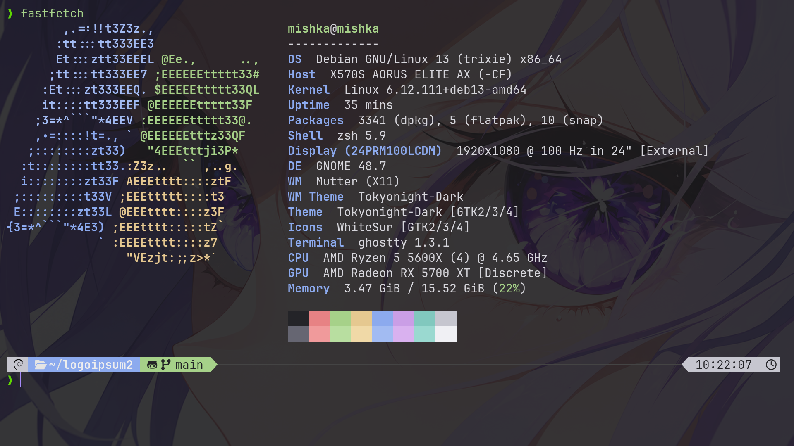

# Debian Dotfiles

My personal Debian Linux desktop configuration featuring a minimal dark theme, a transparent Ghostty terminal, Zsh with Powerlevel10k, and Fastfetch.

## Preview



## Setup

| Component | Software |
|---|---|
| Operating System | Debian 13 |
| Desktop Environment | GNOME |
| Terminal | Ghostty |
| Shell | Zsh |
| Prompt | Powerlevel10k |
| System Information | Fastfetch |
| Font | JetBrainsMono Nerd Font |
| Theme | Dark Graphite |
| Package Manager | APT |

## Features

- Minimal dark theme with a `#19191B` background
- Transparent Ghostty terminal with blur
- Colorful Powerlevel10k prompt with Git integration
- Zsh syntax highlighting and autosuggestions
- Custom aliases and shell functions
- FZF integration for command history
- Fastfetch with custom colors and logo
- JetBrains Mono font with Nerd Font icons

## Repository Structure

```text
debian-dotfiles/
├── configs/
│   ├── ghostty/
│   │   └── config
│   ├── zsh/
│   │   └── .zshrc
│   ├── powerlevel10k/
│   │   └── .p10k.zsh
│   └── fastfetch/
│       └── config.jsonc
├── screenshots/
│   ├── desktop.png
│   └── terminal.png
├── .gitignore
├── LICENSE
└── README.md
```

## Installation

### 1. Clone the repository

```bash
git clone https://github.com/mishk22555-ux/linux-rice.git
cd debian-dotfiles
```

Replace `YOUR_USERNAME` with your GitHub username.

### 2. Install dependencies

On Debian-based distributions:

```bash
sudo apt update
sudo apt install -y zsh git curl fzf \
   
